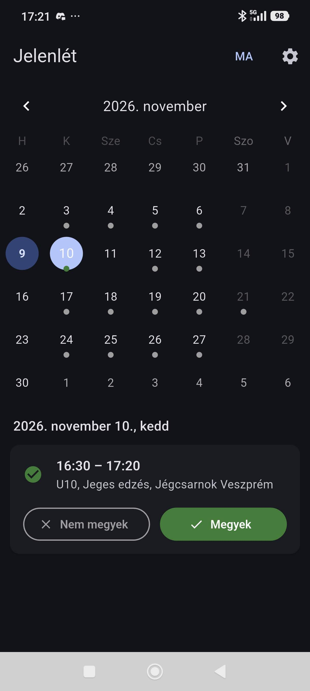
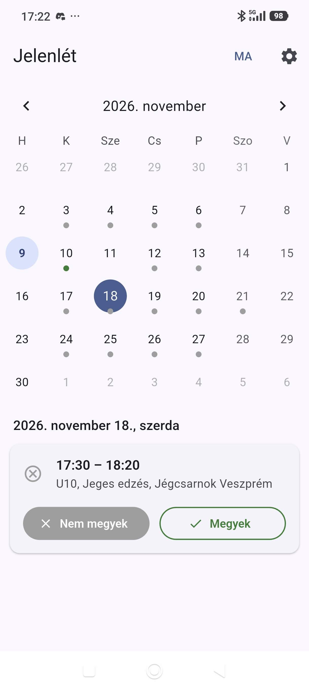

# Jelenlét – Jéglovagok (nem hivatalos Android és web kliens)

Nem hivatalos Android és webes alkalmazás, amellyel az edzésekre való jelentkezést lehet kezelni. Az app a saját fiókoddal csatlakozik a [https://jeglovagok.teamadmin.hu/](https://jeglovagok.teamadmin.hu/) oldalhoz, és ugyanazokat az adatokat mutatja, mint a weboldal.

> Az alkalmazás nem a TeamAdmin és nem a Jéglovagok hivatalos fejlesztése. A jelszavadat csak a telefonod (a webes verziónál a böngésződ) tárolja titkosítva, és bejelentkezéskor csak a teamadmin.hu oldalra küldi el – a webes verzió ezt egy közvetítőn keresztül teszi, ami semmit nem tárol és nem naplóz.

## Funkciók

- Havi naptár az edzések időpontjaival – zöld pont: megyek, szürke pont: nem megyek
- Jelentkezés vagy lemondás egy gombnyomással (a következő 5 hét edzéseire)
- „MA” gomb, amellyel a mai napra ugrik
- Automatikus frissítés: indításkor szól, ha van új verzió
- Visszajelzés küldése emailben
- Világos és sötét téma

## Képernyőképek

  
  &nbsp;&nbsp;
  

## Webes alkalmazás

Böngészőből is használható, bármilyen eszközön (iPhone, Android, számítógép): **[https://jelenlet.netlify.app/](https://jelenlet.netlify.app/)**

  

A gomb megnyitja az alkalmazást, és felajánlja a telepítést – a megjelenő **„Telepítés”** gombra koppintva az app a kezdőképernyőre kerül.

- **Android / számítógép (Chrome, Edge):** a megjelenő „Telepítés” gombbal egy koppintással telepíthető.
- **iPhone / iPad (Safari):** az Apple nem engedi a közvetlen telepítést; koppints a Megosztás gombra, majd a **„Főképernyőhöz adás”** lehetőségre.

A webes verzió mindig a legfrissebb, külön frissíteni nem kell. A teamadmin.hu felé a kéréseket egy közvetítő továbbítja (a böngésző közvetlenül nem érheti el az oldalt); ez semmit nem tárol és nem naplóz.

## Letöltés

📱 **[Legújabb Android verzió letöltése](https://github.com/csipetcsabi/team-admin-releases/releases/latest)**

## Telepítés (Android APK)

1. Töltsd le az APK fájlt a telefonodra
2. Nyisd meg a letöltött fájlt
3. Ha kéri, engedélyezd az ismeretlen forrásból történő telepítést
4. Kövesd a telepítő utasításait

> **Play Protect figyelmeztetés:** mivel az alkalmazás nem a Play Áruházból származik, az Android figyelmeztethet, hogy ismeretlen fejlesztőtől van. Ilyenkor válaszd a „További részletek”, majd a „Telepítés mindenképp” lehetőséget.

## Frissítés

Az alkalmazás indításkor ellenőrzi, van-e újabb verzió, és ha van, egy gombnyomással letölti és telepíti. Az aktuális verzió: lásd [version.json](version.json).

## Visszajelzés

Hibát találtál vagy ötleted van? Az alkalmazásban: **Beállítások → Visszajelzés küldése**, vagy írj a [csipetcsabi@gmail.com](mailto:csipetcsabi@gmail.com) címre.
